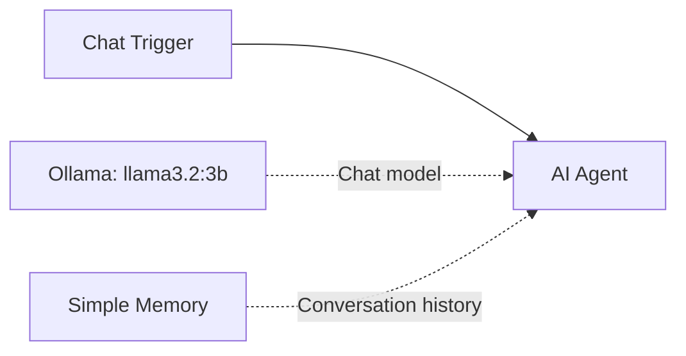

# Ask Nafiis

**An AI hotel assistant for the Nafiis hotel management system.**

Ask Nafiis brings a guest-facing chat interface together with **Next.js**, **n8n**, and local **Ollama**. The integration kit can answer supported room, menu, and contact questions from your configured public hotel data, while the n8n workflow supplies model-based conversation.

This repository is a portfolio and integration sample extracted from our hotel project. Start with the [hotel integration guide](hotel-chatbot/README.md) for the **Ask Nafiis** chat panel, API bridge, and fast public-data answers. You can also import the workflow on its own for local chat. The complete hotel management system and its booking/payment backend are not included.

[Hotel integration guide](hotel-chatbot/README.md) · [Importable workflow](workflows/ai-chatbot.json) · [Developer portfolio](https://github.com/Abdiaziz-Adem)

## Scope at a glance

| Layer | What it provides |
| --- | --- |
| Next.js integration kit | Ask Nafiis widget, API bridge, and supported public hotel-data answers after configuration. |
| n8n + Ollama workflow | Local AI conversation with short session memory and the Ask Nafiis identity. |
| Deployment status | Source samples only. Publishing this repository does not run the chatbot or change the hotel website. |

## How it works



The AI Agent identifies itself as **Ask Nafiis**, the hotel's AI assistant, and uses a local `llama3.2:3b` model. Supply approved hotel facts before using AI replies with guests. Simple Memory retains a short conversation window for each chat session. There are no external action tools or live database queries.

## Set up

1. Install and run [n8n](https://docs.n8n.io/hosting/) and [Ollama](https://ollama.com/). The source workflow was exported from n8n **2.43.5**; use a compatible version supporting the included node versions.
2. Download the model on the machine running Ollama:

   ```sh
   ollama pull llama3.2:3b
   ```

3. In n8n, create a workflow and choose **Import from File** from the workflow menu. Select [`workflows/ai-chatbot.json`](workflows/ai-chatbot.json).
4. Open **Ollama Chat Model** and create/select your own **Ollama** credential. Set its Base URL to the Ollama service reachable from n8n:

   | Installation | Example Base URL |
   | --- | --- |
   | n8n and Ollama both running directly on the same machine | `http://localhost:11434` |
   | n8n in Docker Desktop, Ollama on the host | `http://host.docker.internal:11434` |
   | Both services in the same Docker network, Ollama service named `ollama` | `http://ollama:11434` |

   These are examples, not saved connections. The Ollama listener and container networking must allow n8n to reach it. Do not expose Ollama publicly just to fix a connection problem.

5. Save the workflow and open n8n's manual chat panel. Send `Hello, what can you help me with?`.
6. Test memory by giving a fictional name, then asking what name you provided in the same session. Start a new session to test isolation. The exported Simple Memory node keeps a context window of **1**; increase it in the node if you need longer conversations.

## Customize

- Edit **AI Agent → Options → System Message** to describe your assistant and supply approved facts.
- Change the model in **Ollama Chat Model** after pulling that model in Ollama.
- Add tools only if you intentionally want the assistant to perform other actions. The supplied workflow cannot access accounts, make reservations, send messages, process payments, or write blockchain transactions.

## Optional hosted or embedded chat

The import is **inactive**, and **Make Chat Publicly Available** is **off**. Manual chat can be tested before publishing.

To host a chat later, configure the Chat Trigger's authentication, enable its public-chat setting, and publish/activate the workflow. **Hosted Chat** gives you n8n's chat page. **Embedded Chat** requires a separate interface calling the Chat URL displayed by your own n8n instance.

For internet use, set up HTTPS, authentication and request limits. Choose allowed origins for your frontend. Treat n8n execution history and memory as potentially containing chat messages; configure retention and access for your use case. Simple Memory is not a durable shared conversation store for multiple workers.

Publishing this repository on GitHub stores the workflow and instructions. It does **not** run n8n, run Ollama, or deploy a chatbot website. AI speed depends on your model and hardware. Fast hotel-database answers live in the separate [hotel-chatbot integration kit](hotel-chatbot/README.md), not in the n8n workflow.

## What was removed from the export

- Saved credential references and deployment-specific workflow metadata.
- Pinned/sample execution data and original webhook identifiers.
- Private hotel facts and contact details. The public prompt identifies Ask Nafiis but includes no room prices, availability, or customer data.
- An unused, disconnected legacy Webhook node.

No credential export, API key, private environment file, conversation history, or customer records are included. Importing the workflow requires creating your own Ollama connection.

## Validation

The exported JSON was checked for valid node connections and removal of source credential references and hotel contact details. The original standalone workflow was also imported into a fresh temporary n8n instance. The Ask Nafiis branding update preserves its node connections, model, inactive state, and credential-free configuration; the updated export was checked as JSON. Connecting an Ollama credential and running inference remain local setup steps for each installation.

## Official documentation

- [Export and import n8n workflows](https://docs.n8n.io/workflows/export-import/)
- [Chat Trigger](https://docs.n8n.io/integrations/builtin/core-nodes/n8n-nodes-langchain.chattrigger/)
- [Ollama credentials](https://docs.n8n.io/integrations/builtin/credentials/ollama/)
- [Ollama and n8n](https://github.com/ollama/ollama/blob/main/docs/integrations/n8n.mdx)
